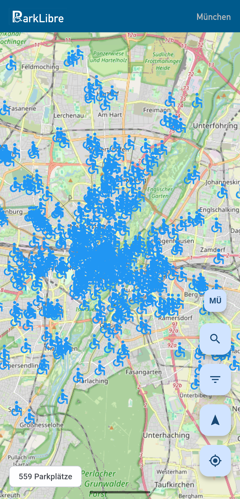
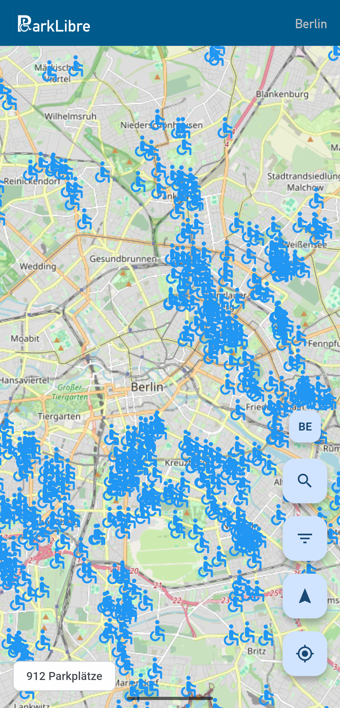
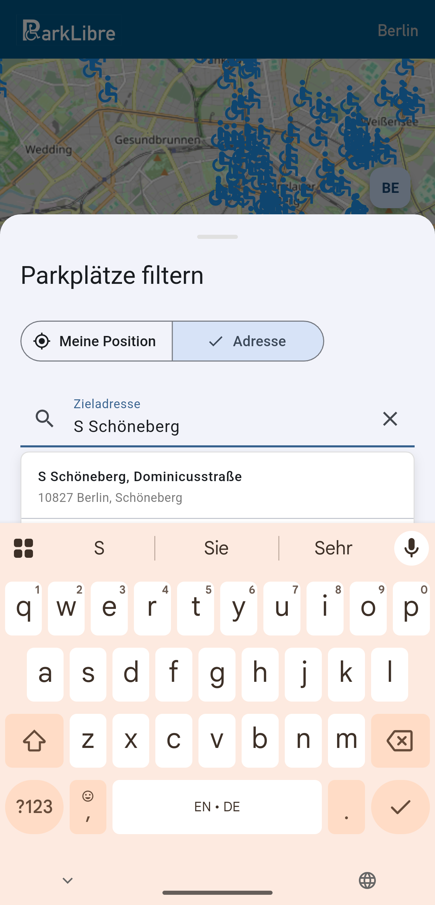

<!--
SPDX-FileCopyrightText: 2026 Johannes Näder <git@pub.nextwelt.de>

SPDX-License-Identifier: GPL-3.0-or-later
-->

# ParkLibre

[](LICENSES/GPL-3.0-or-later.txt)
[](https://flutter.dev)

**Find accessible parking spots in German cities** | **Behindertenparkplätze in deutschen Städten finden**

<p align="center">
  
  
  
</p>

---

## 🇬🇧 English

### About This Project

**Disclaimer: This is my first app. I'm not a developer — this was built through *vibe coding* with AI assistance.**

ParkLibre is an experiment exploring the challenges and opportunities of vibe coding, especially in the context of Free Software. It was created using AI models (**MiniMax**, **Kimi 2.5**, **GLM-5**) through OpenCode with **Nebius**, **Zen**, and **OpenCode Go** as AI service providers.

**Time investment:** ~5-7 hours of prompting (and much of it waiting and testing). Compliance checks, licensing, and release preparation took significantly longer.

**Current status:** Functional on several tested Android devices, but still very much an MVP. Many useful features are missing. Since I only partially understand the code myself, I'm very interested in feedback!

### Why This App?

Finding accessible parking for people with disabilities is currently difficult. While spots are available in OSM and Wheelmap, what's missing is a way to search for them specifically and navigate to them. I hope this app makes it easier for many people.

### Features

- 🗺️ **Interactive Map** with parking spots for Berlin, Munich, and Dresden
- 🔍 **Address Search** — find spots near your destination
- 🧭 **One-Tap Navigation** — navigate to the nearest available spot
- 📍 **Filter by Radius** — show only spots within walking distance
- 🌐 **Open Data** — uses official city APIs (WFS services)

### Supported Cities

| City | Data Source | Coverage |
|------|------------|----------|
| Berlin | [Geoportal Berlin](https://daten.berlin.de/) | ~900 spots |
| Munich | [Open Data Portal Munich](https://opendata.muenchen.de/) | ~550 spots |
| Dresden | [Stadt Dresden Open Data](https://opendata.dresden.de/) | ~480 spots |

### Download

📱 **Android APK**: [Releases](https://codeberg.org/johas/parklibre/releases)

Minimum requirement: Android 8.0 (API 26)

### Build from Source

```bash
flutter pub get
flutter build apk --release
```

#### Linux Development

To build and test on Linux (without navigation functionality):

```bash
flutter pub get
flutter run -d linux
```

Navigation features are disabled on Linux as they require mobile-specific APIs.

### AI Models License Note

The AI models used to create this app (MiniMax, Kimi 2.5, GLM-5) are **not Free Software**. While ParkLibre itself is GPL-3.0 licensed, the tools used to create it have their own proprietary licenses.

### What's Next?

- [ ] More cities (Hamburg, Cologne, Frankfurt...) and more regions (potentially Overpass API)
- [ ] Offline caching

---

## 🇩🇪 Deutsch

### Über dieses Projekt

**Hinweis: Dies ist meine erste App. Ich bin kein Entwickler — dies wurde durch *Vibe Coding* mit KI-Unterstützung erstellt.**

ParkLibre ist ein Experiment, das die Herausforderungen und Chancen von Vibe Coding erkundet, besonders im Umfeld Freier Software. Erstellt mit KI-Modellen (**MiniMax**, **Kimi 2.5**, **GLM-5**) über OpenCode mit **Nebius**, **Zen** und **OpenCode Go** als KI-Service-Provider.

**Zeitaufwand:** ~5-7 Stunden Prompting (und viel Warten und Testen). Compliance-Prüfungen, Lizenzierung und Veröffentlichungsvorbereitung haben deutlich länger gedauert.

**Aktueller Status:** Funktioniert auf mehreren getesteten Android-Geräten, aber immer noch ein MVP. Viele nützliche Funktionen fehlen. Da ich den Code selbst nur ansatzweise verstehe, bin ich sehr an Feedback interessiert!

### Warum diese App?

Behindertenparkplätze zu finden ist aktuell schwierig. Sie sind zwar z.B. in OSM und Wheelmap zu finden, aber was fehlt, ist eine Möglichkeit, sie gezielt zu suchen und hinzunavigieren. Ich hoffe, dass das mit dieser App für viele Menschen einfacher wird.

### Funktionen

- 🗺️ **Interaktive Karte** mit Parkplätzen für Berlin, München und Dresden
- 🔍 **Adresssuche** — finde Plätze in der Nähe deines Ziels
- 🧭 **Navigation per Knopfdruck** — navigiere zum nächsten freien Platz
- 📍 **Filter nach Radius** — zeige nur Plätze in Laufnähe
- 🌐 **Open Data** — nutzt offizielle Stadt-APIs (WFS-Dienste)

### Unterstützte Städte

| Stadt | Datenquelle | Abdeckung |
|-------|------------|-----------|
| Berlin | [Geoportal Berlin](https://daten.berlin.de/) | ~900 Plätze |
| München | [Open Data Portal München](https://opendata.muenchen.de/) | ~550 Plätze |
| Dresden | [Stadt Dresden Open Data](https://opendata.dresden.de/) | ~480 Plätze |

### Download

📱 **Android APK**: [Releases](https://codeberg.org/johas/parklibre/releases)

Mindestanforderung: Android 8.0 (API 26)

### Aus dem Quellcode bauen

```bash
flutter pub get
flutter build apk --release
```

#### Linux-Entwicklung

Um unter Linux zu bauen und zu testen (ohne Navigations-Funktionalität):

```bash
flutter pub get
flutter run -d linux
```

Navigations-Funktionen sind unter Linux deaktiviert, da sie mobile-spezifische APIs benötigen.

### Hinweis zu KI-Modell-Lizenzen

Die KI-Modelle, die zur Erstellung dieser App verwendet wurden (MiniMax, Kimi 2.5, GLM-5), sind **keine Freie Software**. Während ParkLibre selbst unter GPL-3.0 lizenziert ist, haben die verwendeten Werkzeuge ihre eigenen proprietären Lizenzen.

### Was kommt als Nächstes?

- [ ] Mehr Städte (Hamburg, Köln, Frankfurt...) und weitere Regionen (potentiell Overpass API)
- [ ] Offline-Caching

---

## 📄 License

This project is licensed under **GPL-3.0-or-later**.

See [LICENSES/GPL-3.0-or-later.txt](LICENSES/GPL-3.0-or-later.txt) for the full license text.

### Font License

The app uses "U DIN 1451 Mittelschrift" font, licensed under OFL-1.1 (Open Font License).
Source: [Font Library](https://fontlibrary.org/face/u-din-1451-mittelschrift)

---

## 🤝 Contributing & Feedback

Since this is a learning project, I'm especially interested in:
- Bug reports
- Feature requests

Please open an issue on Codeberg.

---

## 🙏 Acknowledgments

- Thanks to the cities of Berlin, Munich, and Dresden for providing open data
- Thanks to OpenStreetMap contributors
- Thanks to the Flutter and Dart communities

---

**Made with ❤️ and 🤖 in Germany**
